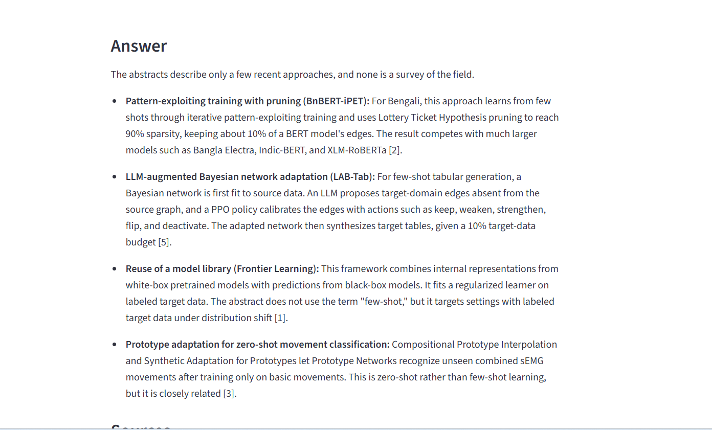

# arXiv Research Assistant (RAG)

An LLM-powered research assistant that answers questions about machine learning and NLP research using **retrieval-augmented generation (RAG)**. It searches 2,821 recent arXiv paper abstracts, retrieves the most relevant ones, and has Claude write an answer that cites its sources.



## How it works

```
Question → Embed question → Search ChromaDB (top 5 abstracts) → Claude writes a cited answer → Streamlit UI
```

1. **Data collection:** downloaded 2,821 papers from the arXiv API (categories cs.CL and cs.LG) and cleaned them into `arxiv_clean.csv`.
2. **Embedding:** converted each abstract into a vector with `sentence-transformers` (`all-MiniLM-L6-v2`).
3. **Vector store:** stored the vectors in a local ChromaDB database.
4. **Retrieval:** a question is embedded with the same model, and ChromaDB returns the 5 closest abstracts.
5. **Generation:** the 5 abstracts are sent to Claude (Anthropic API), which answers using **only** those abstracts, cites them as [1]–[5], and says so when the papers don't contain the answer.
6. **Interface:** a Streamlit web app shows the answer and expandable sources with links to each paper on arXiv.

## Tech stack

Python · sentence-transformers · ChromaDB · Anthropic API (Claude Haiku 5.5) · Streamlit · pandas

## Evaluation

I measured retrieval quality with **synthetic evaluation**: for 20 randomly sampled papers, Claude wrote a question that the paper answers, and I checked whether retrieval returned that paper in the top 5.

| Test | Hit rate @5 | MRR |
|---|---|---|
| Easy: technical questions using the paper's own vocabulary | 100% | 1.00 |
| Hard: short, everyday questions with no technical terms | 60% | 0.42 |

**Takeaway:** retrieval is near-perfect when questions use the paper's terminology but drops for vague, everyday phrasing, which is closer to how real users ask. Some "misses" on the hard test may still be useful answers, since broad questions often match several relevant papers. With 20 questions, these are rough estimates.

## Project structure

| File | Purpose |
|--